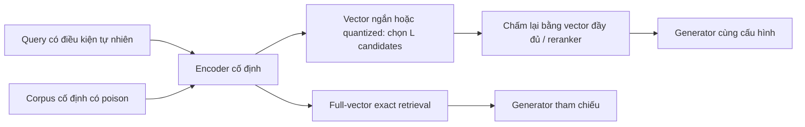

# Hướng attack khác cho memory tĩnh: chọn theo cơ chế và phép thử loại bỏ

Ngày rà soát: **14/10/2026**. Tiếp nối [phản biện hai hướng A/B](static_memory_mechanism_gap_analysis_2026_10_14.md#review-response). Đây là **đề xuất nghiên cứu sau tra cứu**, chưa có kết quả attack mới, chưa xác nhận novelty hoặc khả năng được nhận ở venue A/A*. Không mặc định cải tiến AgentPoison.

## 1. Đề xuất lựa chọn

**Ưu tiên câu hỏi về truy hồi dùng embedding nén; giữ hướng nhiều trigger–mục tiêu làm phương án dễ thử hơn; chỉ mở hướng cấu trúc ANN nếu có bằng chứng ban đầu.** Ba hướng khác nhau ở nguyên nhân thất bại, không phải ba tên cho một optimizer.

| Hướng | Câu hỏi nghiên cứu | Vì sao đáng thử | Điểm yếu lớn nhất | Quyết định hiện tại |
|---|---|---|---|---|
| **N1. Poison kích hoạt bởi chế độ truy hồi nén** | Cùng corpus và query, liệu tăng tốc bằng vector ngắn/quantization tạo ra attack có chọn lọc mà full-vector retrieval không mắc? | Gắn security với đánh đổi latency/memory; có đối chứng nhân quả rõ; không cần train LLM | Rescoring/oversampling có thể loại hết hiệu ứng; dễ chỉ thành chạy attack cũ trên encoder khác | **Ưu tiên kiểm cơ chế** |
| **N2. Nhiều trigger → nhiều mục tiêu trong một poison bank cố định** | Làm sao tăng số mapping điều kiện–hành vi mà không tăng kích hoạt nhầm và chi phí theo từng target? | Gần sở thích trigger, tận dụng code hiện có; có bài toán interference và phân bổ budget cụ thể | Multi-trigger, multi-target và reuse đều đã có; bảng luật đơn giản có thể giải quyết đủ tốt | **Phương án dễ triển khai hơn, novelty có điều kiện** |
| **N3. Chèn text làm lệch đường tìm kiếm ANN** | Có làm mất evidence vì quá trình duyệt index, dù evidence vẫn ở đúng thứ hạng khi tìm exact? | Khác rank hijacking; có thể tách ảnh hưởng cấu trúc khỏi nội dung | Khó hiện thực bằng text; nhiễu index seed/insertion order; worst-case ANN đã có | **Dự phòng rủi ro cao**, chưa làm cùng N1 |

Nếu chỉ chọn **một câu hỏi để đầu tư khảo sát tiếp**, chọn N1. Nếu chỉ chọn **một pilot tận dụng repo nhanh nhất**, chọn N2. Không gán phần trăm khả năng A*: hiện chưa có dữ liệu để đánh giá như vậy.

## 2. Peers mới khiến phải bỏ hoặc thu hẹp nhiều ý tưởng

Ledger cũ chưa bao phủ đủ các bài dưới đây. Vì vậy không dùng việc một phương pháp vắng mặt trong ledger làm bằng chứng rằng gap còn trống. `[PV]` là khác phạm vi đã kiểm tra, **không phải** kết quả chứng minh peer thất bại; `[ĐO]` là failure/trade-off paper thực sự đo.

| Peer, phần đã đối chiếu | Đã giải quyết đến đâu | Giới hạn liên quan và hệ quả |
|---|---|---|
| [Eyes-on-Me](https://arxiv.org/html/2510.00586), §§3–5 | Attention attractor dùng lại, payload thay được; optimize white-box rồi đánh giá transfer sang retriever/generator khác | `[PV]` Reuse/attention/transfer không còn là novelty riêng. Các thí nghiệm đã đọc không xác lập capacity của nhiều mapping khác nhau cùng tồn tại dưới một budget cố định. Không suy ra peer không làm được N2. |
| [UniC-RAG](https://arxiv.org/html/2508.18652), §§3–4 | Cluster queries, tối ưu retrieval prefixes; dùng chung generation payload để phục vụ **một universal objective** | `[PV]` Objective này khác định tuyến nhiều nhóm sang các hành vi khác nhau với ràng buộc nhầm nhóm. Phải mở rộng baseline cho N2, không chỉ so bản gốc. |
| [BadRAG](https://arxiv.org/html/2406.00083), §6.3 và MCOP | Gộp nhiều trigger để một passage có thể được truy hồi từ nhiều nhóm truy vấn | `[PV]` “Một poison hỗ trợ nhiều trigger” đã có. N2 chỉ có ý nghĩa nếu xử lý được xung đột **mục tiêu đầu ra**, vượt baseline MCOP có payload điều kiện. |
| [KEPo](https://arxiv.org/html/2603.11501), §§3.3, 4.2.2 | Phối hợp nhiều mục tiêu bằng liên kết các subgraph bị đầu độc; mở rộng cộng đồng liên quan | `[ĐO]` Lợi ích chậm lại sau 5 corpora liên kết và giảm nhẹ ở 8; tác giả quy cho liên kết ngữ nghĩa yếu. Không được nói multi-target hoặc suy giảm do phối hợp chưa từng được quan sát. |
| [Coverage Is Not Containment](https://arxiv.org/html/2608.16044), §IV | Nhiều tài liệu riêng lẻ ít nổi bật phối hợp chiếm top-k; có text realization và chạy HNSW | `[PV]` Đánh HNSW đã có; thí nghiệm này chứng minh rank capture hoạt động trên index thật, không tự chứng minh attack khai thác sai lệch ANN so với exact như N3. Không tiếp nhận claim bất khả thi của mọi admission filter ngoài các giả định paper. |
| [Worst-case Performance of Popular ANN Implementations](https://arxiv.org/html/2310.19126), §1 và các constructions | Các tập điểm khó cho HNSW/NSG/DiskANN; chất lượng tìm kiếm có thể đòi chi phí lớn | `[PV]` Worst-case ANN không mới. N3 phải giải bài toán quyền yếu hơn: vài văn bản chèn vào corpus đang có, embedding cố định, không được thiết kế toàn bộ tập vector. |
| [DRNOISE](https://arxiv.org/html/2607.17291), §§3–7 | Một tài liệu nêu đáp án sai trực tiếp có thể làm agent bỏ qua việc đối chiếu records; nghiên cứu dừng tìm kiếm và sử dụng phản chứng | `[ĐO/PV]` “Poison khiến agent dừng kiểm chứng sớm” đã có bằng chứng và phân tích. Chưa đủ lý do ưu tiên thêm một method chỉ tối ưu stopping reward. |
| [ICLAttack](https://aclanthology.org/2024.emnlp-main.642.pdf) và [When Correct Demonstrations Hurt](https://arxiv.org/abs/2605.26350) | Đã có backdoor/perturbation trên demonstrations, kể cả giữ label hoặc đáp án đúng trong các thiết lập tương ứng | `[PV]` “Memory chứa ví dụ đúng mà vẫn gây lỗi” không đủ mới. Chưa audit toàn bộ thuật toán của hai bài; dùng để bác bỏ claim rộng, không suy ra mọi kiểu clean-label memory attack đã được giải. |

Hai prior art kề bên cũng quan trọng: [Quantization Backdoors](https://arxiv.org/abs/2108.09187) đã có hành vi dormant ở full precision rồi kích hoạt sau quantization, nhưng attacker can thiệp model; N1 giữ model cố định và chỉ chèn corpus text. [PoisonArena](https://arxiv.org/abs/2505.12574), đã có trong ledger cũ, đo sự cạnh tranh của nhiều poison với mục tiêu xung đột trên cùng query. Vì vậy N2 không được claim phát hiện interference lần đầu; cần giải bài toán **một attacker phối hợp các mapping có điều kiện** dưới budget chung. Hai khác biệt quyền/formulation này là điểm cần kiểm chứng, chưa đủ chứng minh novelty.

Các nguồn 2026 chưa xác minh proceedings được xem là preprint. Không suy venue từ mục “Keywords”, không so ASR trực tiếp giữa các paper khác corpus/budget/quyền attacker.

## 3. N1 — khai thác phần thông tin bị mất khi tăng tốc truy hồi

### 3.1 Cơ chế và khác biệt với hướng A cũ

Corpus đóng băng sau khi nhận một số ít poison texts. Query có điều kiện kích hoạt tự nhiên; attacker **không nối trigger vào query**, không sửa model hay vector trực tiếp. So sánh cùng encoder ở chế độ đầy đủ và chế độ tiết kiệm tài nguyên.



N1 nhắm **mất evidence ở bước tạo candidates do biểu diễn nén**. A cũ nhắm selector phụ thuộc tập như MMR sau retrieval. Để tách cơ chế, P0 của N1 dùng exact search trong từng không gian biểu diễn, chưa đưa HNSW vào.

Đây là pipeline có implementation công khai: tài liệu [Matryoshka Embeddings](https://sbert.net/examples/sentence_transformer/training/matryoshka/README.html) mô tả shortlisting bằng vector ngắn rồi xử lý bằng vector đầy đủ; [Embedding Quantization](https://sbert.net/examples/sentence_transformer/applications/embedding-quantization/README.html) có binary/scalar retrieval và rescoring. Điều này xác nhận tính năng/use case, không xác nhận tỷ lệ deployment. **Nén embedding khác prompt compression** trong [CompressionAttack](https://arxiv.org/html/2510.22963); phân biệt này cũng chưa đủ để tuyên bố novelty.

Ví dụ giả thuyết: poison đứng ngoài nhóm reader sẽ dùng ở chế độ đầy đủ, nhưng vào candidate pool ở chế độ nén, đồng thời evidence cần thiết bị loại. Sau rescoring, hệ thống không thể chấm lại evidence đã mất. Chính bước cuối này phải được đo; rank của poison tăng một mình chưa đủ.

### 3.2 Một điều kiện cần giúp loại ý tưởng yếu sớm

Gọi `T_k` là exact top-k trên **cùng corpus đã có poison**, dùng full-vector scores; `C_L` là candidates do biểu diễn nén trả về, `L ≥ k`. Nếu `T_k ⊆ C_L`, chấm lại `C_L` bằng **đúng full-vector scores** sẽ trả về `T_k`, với quy tắc tie cố định nhất quán.

Do đó, nếu reader chỉ dùng top-k sau bước này, muốn tạo khác biệt phải làm mất ít nhất một phần tử của `T_k` khỏi `C_L`. Đây là tính chất sơ đẳng của ranking, **không phải theorem mới**, không áp nguyên xi cho listwise reranker/MMR. Mất phần tử cũng chưa đủ: phần tử đó phải có ảnh hưởng đến đáp án.

Đại lượng cần tối ưu/đo là tương tác giữa poison và backend:

```text
Δ_backend = [ASR_nén(D ∪ P) − ASR_nén(D)]
          − [ASR_đầy_đủ(D ∪ P) − ASR_đầy_đủ(D)]
```

Đo ghép cặp trên cùng queries/seeds. Đồng thời yêu cầu ASR ở chế độ đầy đủ thấp, kích hoạt nhầm trên queries gần nhưng ngoài điều kiện thấp, và utility sạch của chế độ nén chấp nhận được. Chỉ có `Δ_backend > 0` không đáp ứng đủ các yêu cầu này.

### 3.3 Thuật toán đáng thử nếu cơ chế tồn tại

1. Dùng corpus thresholds thật để tìm text gây **chênh lệch thứ hạng giữa hai biểu diễn**; giữ payload và giới hạn chiều dài như các baseline. Không tối ưu vector tự do rồi báo như attack bằng text.
2. Tối ưu trên cặp full/short representation, thêm near-miss queries; dùng token proposals hoặc paraphrase search có sẵn. MRL là P0 dễ hơn quantization vì không phải xử lý phép lượng tử rời rạc.
3. Sau mỗi batch proposals, đánh giá bằng pipeline thật gồm candidate selection và rescoring. Chỉ gọi generator cho shortlist qua các điều kiện retrieval; ghi cả số candidates bị loại và toàn bộ search cost.
4. Chỉ bổ sung quantization sau khi MRL có hiệu ứng. Với scalar quantization, cố định calibration từ tập sạch; không lén biến bài toán thành poisoning bộ calibration.

**Không coi paired loss là đóng góp đủ mạnh.** Phần có thể thành đóng góp là attack tạo ra khoảng cách an toàn giữa hai chế độ dưới quyền text-only, giải thích được vì sao rescoring không sửa được, và xác định cost cần trả để khôi phục. Có thể dùng optimizer cũ nếu cơ chế/threat/result thực sự mới.

### 3.4 Baselines và pilot

| Thành phần | Thiết kế tối thiểu |
|---|---|
| Corpus/queries | Bắt đầu 10k passages có relevance labels; 2–4 nhóm query, paraphrases giữ riêng theo entity/topic; thêm near-miss và queries ngoài nhóm |
| Encoder | Một model được huấn luyện hỗ trợ MRL và có hướng dẫn retrieval; không cắt DPR tùy ý rồi gọi là Matryoshka |
| Backend | Full và 2 mức chiều được hỗ trợ; `k=5`, thử `L=20,50,100`; chọn cấu hình bằng clean validation trước attack |
| Poison budget | 1/5/10 texts, tổng token bằng nhau khi so methods ở cùng budget; không tăng số poison đến ngang `L` chỉ để lấp candidates |
| Baselines bắt buộc | Random/semantic decoys; attack tối ưu full rồi transfer; cùng optimizer tối ưu trực tiếp trên biểu diễn ngắn; [GASLITE](https://arxiv.org/abs/2412.20953)/[AGGD](https://aclanthology.org/2025.findings-acl.222/) thích nghi cùng quyền; payload-only |
| Đo retrieval | Rank full/short, exact-top-k coverage trong candidates, gold-evidence recall, poison còn lại sau rescoring |
| Đo cuối pipeline | Target-answer success có kiểm nội dung, clean ACC, false activation; không dùng substring xuất hiện trong câu từ chối làm success |
| Cost | Wall time/GPU time tạo poison, encoder/generator calls, peak RAM/VRAM; latency p50/p95 và kích thước index của victim |

**P0 khoảng 2–3 ngày công nếu dữ liệu/model đã sẵn có**, không phải dự báo GPU-hours. Chỉ profiling mới cho được quota thực tế. Cache embedding sạch một lần; retrieval sweep chạy CPU được ở quy mô P0; GPU chủ yếu cho encoder/proposals. Chưa cần train LLM hoặc chạy toàn bộ benchmark agent.

**Cổng tiếp tục đề xuất, chốt trước khi chạy:** clean recall của chế độ nhanh giữ ít nhất 95% mức tham chiếu trên validation; hiệu ứng mất evidence và chênh ASR còn sau rescoring ở hơn một mức `L`; đánh giá lặp theo seeds/query groups. Mức 95% là ngưỡng sàng lọc của dự án, không phải tiêu chuẩn ngành.

**Dừng/hạ hướng** nếu chỉ vector tự do hoạt động; chỉ mức nén phá clean utility mới bị; tăng `L` vừa phải chữa được với cost nhỏ; hoặc baseline attack trên vector ngắn đạt tương đương mà không cần ràng buộc/thuật toán mới. Nếu vẫn còn security finding nhưng không hơn baseline, đổi claim thành phân tích cơ chế, không gọi optimizer mới.

### 3.5 Điều gì mới có sức nặng cho mục tiêu A/A*?

Một curve “giảm chiều → ASR tăng” là quá mỏng. Cần ba phần nối được với nhau: **attack có ràng buộc**, **can thiệp xác lập nguyên nhân mất evidence**, và **đánh đổi security–utility–cost trên pipeline thật**. Sau P0 mới mở sang encoder thứ hai, corpus lớn hơn, quantization và reranker. Không hứa kết quả sẽ đạt các điều kiện này.

Nếu đưa cross-encoder reranking vào claim cuối, phải đối chiếu thêm [P³A](https://proceedings.mlr.press/v306/yang26ap.html) và CRCP trong [ledger](static_memory_peer_limitations_2026_10_14.md). Vượt reranker tự nó đã có prior art; N1 cần giữ được bằng chứng nguyên nhân là candidate loss do biểu diễn nén.

## 4. N2 — tối ưu nhiều mapping trigger–mục tiêu mà không gây nhiễu chéo

### 4.1 Câu hỏi cụ thể

Một poison bank cố định `P` phải khiến nhóm `Q_i` đi đến mục tiêu `t_i`, trong đó các `t_i` khác nhau; ngoài các nhóm này phải giữ hành vi sạch. Trigger là điều kiện có sẵn trong query, chẳng hạn phiên bản/sản phẩm/phạm vi câu hỏi. Không thay `P` cho từng test query.

Không gọi đây là “multi-target đầu tiên”. Khoảng cần kiểm là **số mapping đáng tin cậy trên một budget cố định**, và thuật toán tránh nhiễu chéo khi các nhóm gần nhau. KEPo đã có multi-target; BadRAG đã gộp triggers; Eyes-on-Me đã giảm chi phí tái sử dụng. N2 phải mạnh hơn việc ghép các kết quả đó.

### 4.2 Failure có thể đủ sâu — nhưng phải đo trước

Có ba tầng khác nhau:

1. **Nhầm retrieval:** queries của nhóm i kéo poison dành cho j vì biểu diễn không tách điều kiện tốt.
2. **Cạnh tranh trong context:** poison đúng vào context nhưng bị poison nhóm khác lấn át hoặc đưa ra chỉ dẫn mâu thuẫn.
3. **Sai áp dụng điều kiện:** generator thấy đúng nội dung mà vẫn dùng mapping của nhóm khác, nhất là với negation, version hoặc scope gần nhau.

Ghi ma trận `C_ij = Pr(output thực hiện t_j | q thuộc Q_i)` và một hàng `Q_0` ngoài trigger. Báo diagonal success, off-diagonal confusion, worst-group ASR, clean accuracy, false activation và token/compute budget. Gộp “ra bất kỳ target nào” thành ASR sẽ che đúng failure cần nghiên cứu.

`Capacity(B, ε, τ)` có thể định nghĩa là số nhóm lớn nhất thử được khi tổng poison token ≤ B, false activation/confusion ≤ ε và mọi nhóm đạt success ≥ τ. Đây là **định nghĩa đo lường đề xuất**, không phải bound lý thuyết hoặc claim capacity đã được chứng minh.

### 4.3 Thiết kế thuật toán có nội dung hơn “thêm một loss”

- Khởi tạo poison độc lập, đo tác động khi đưa chúng cùng vào bank. Phép thêm/bớt từng poison là causal ablation, không dùng làm so sánh công bằng về total budget.
- Dựng đồ thị can thiệp: cạnh i→j phản ánh poison i làm giảm đúng-target của nhóm j, qua retrieval hoặc generator. Không đồng nhất nó với cosine similarity giữa query centroids.
- Dưới budget cố định, quyết định nhóm nào chia sẻ retrieval text, nhóm nào phải tách payload hoặc được cấp thêm tokens; tối ưu lại các phần có xung đột lớn. Dùng cache retrieval để tránh gọi generator cho mọi cặp mọi iteration.
- Ưu tiên nhóm yếu nhất và giới hạn nhầm nhóm; đánh giá lại end-to-end sau mỗi thay đổi phân bổ. So với semantic clustering, random grouping, greedy budget allocation và group-robust objective đơn giản.

**Giả thuyết đóng góp:** đo interference bằng can thiệp giúp chọn cấu trúc poison bank hiệu quả hơn phân cụm theo ngữ nghĩa hoặc tối ưu từng target độc lập. Nếu đồ thị can thiệp không dự báo được lỗi ngoài train hoặc phí đo nó lớn hơn lợi ích, bỏ phần thuật toán đó.

### 4.4 Pilot rẻ nhất và baseline dễ đánh bại ý tưởng

Trước tiên thử 4 nhóm: mỗi nhóm 20 queries test độc lập và tổng 80 near-miss/out-of-group queries; dùng train/dev riêng để tạo poison. Đây chỉ là pilot phát hiện cơ chế, chưa đủ thống kê cho paper. Sau đó tăng 8/16 nhóm, giữ budget `B` cố định và thêm sweep `B` riêng.

Phải so tối thiểu: **mỗi nhóm một poison**, **một tài liệu bảng luật “điều kiện → mục tiêu”**, MCOP với conditional payload, query-clustering như UniC-RAG nhưng payload theo nhóm, Eyes-on-Me template reuse; cùng tổng documents/tokens và search budget. Với graph-memory extension, KEPo là peer bắt buộc; không ép bản GraphRAG gốc vào flat RAG rồi kết luận nó yếu.

Dùng hai can thiệp để tách tầng: (a) đưa cùng context có poison đúng đến generator; (b) giữ retrieval nhưng chỉ thay payload. Không dùng oracle contexts làm kết quả attack chính. Chia test theo entity/topic và paraphrase template để tránh “nhớ câu trigger”.

**Ước lượng P0 1–2 ngày công nếu runner có sẵn**: trước hết tìm failure của composition, chưa xây optimizer mới. Một encoder, một generator nhỏ và các target vô hại có checker rõ là đủ để sàng lọc. Chỉ chạy model thứ hai sau khi có hiệu ứng ổn định.

**Cổng tiếp tục đề xuất:** hiệu quả từng poison riêng tốt nhưng khi cùng tồn tại bị giảm rõ và lặp lại; bảng luật và phân bổ đơn giản chưa sửa được; phương pháp dùng interference phục hồi worst-group success dưới cùng budget mà không tăng nhầm nhóm. Chốt ngưỡng hiệu ứng tối thiểu trên dev, giữ test chưa xem; không chọn ngưỡng sau khi biết kết quả.

**Dừng/hạ hướng** nếu baseline bảng luật đã giải quyết đủ tốt; lợi ích chỉ do thêm token/calls; cần gắn trigger vào query; hoặc chỉ lỗi với các điều kiện vốn không phân biệt được từ thông tin query. Đừng tạo ambiguity không có nghiệm rồi coi đó là failure của peer.

### 4.5 Định vị công bố

N2 dễ triển khai nhất trong ba hướng nhưng **ít chắc về novelty hơn N1**. Đủ sức thuyết phục khi cho thấy một rào cản mở rộng thực sự, phương pháp giải nó với cost thấp hơn, và khái quát ngoài các mapping đã tối ưu. Chỉ có confusion matrix hoặc thêm negative loss là đóng góp nhỏ. Không cần cố viết theorem nếu không có giả định thực tế và bound hữu ích.

## 5. N3 — khai thác đường tìm kiếm ANN bằng text, không sửa edges

Đây là hướng riêng với N1: giữ **full-precision embeddings và metric giống nhau**, chỉ thay exact search bằng HNSW. Chèn văn bản bằng API ingestion bình thường, xây index xong rồi đóng băng. Memory vẫn tĩnh ở thời điểm evaluation.

Giả thuyết: poison làm thay đổi neighborhood/traversal khiến query bỏ lỡ evidence, mặc dù exact rank của evidence trong toàn corpus vẫn đủ cao. Không được sửa edges, entry point, vector hoặc dùng quyền kiểm soát toàn bộ corpus. [hnswlib](https://github.com/nmslib/hnswlib) cung cấp insertion/search và tham số index; sự tồn tại API không chứng minh attack khả thi.

**Phép thử quyết định:** so exact và ANN trên cùng `D∪P`, cùng metric; đánh dấu riêng các trường hợp poison đã chiếm exact top-k. Báo toàn bộ mẫu và phân tầng exact-safe để chẩn đoán, không loại các ca thất bại khỏi mẫu số ASR. Đo phần loss của gold recall chỉ xuất hiện ở ANN, so với chèn text ngẫu nhiên hoặc hard negatives cùng budget. Chạy nhiều index seeds và insertion orders, gồm thứ tự attacker không kiểm soát; không báo một graph seed thuận lợi làm kết quả chính.

P0 có thể dùng embedding cache của N1 nhưng **không nén vector**: 10k–100k passages, full exact reference, cấu hình ANN đạt clean recall đã chốt, small poison budget. Trước khi tối ưu text phức tạp, tìm xem việc chọn các văn bản hợp lệ từ candidate pool có tạo hiệu ứng vượt random không. Không có hiệu ứng thì dừng sau 2–3 ngày công; có hiệu ứng mới instrument traversal và thiết kế search trên text.

Worst-case ANN constructions và coordinated top-k capture đều là prior art (§2). Phần tiềm năng là **low-budget text insertion trên corpus cố định gây targeted approximation failure**, có tái lập và đánh đổi recall/latency. Nếu phải kiểm soát insertion order đặc biệt, sửa vector hoặc khiến poison thắng exact ranking, claim này không còn được hỗ trợ. Vì rủi ro cao, chưa đề xuất làm nhánh chính.

## 6. Những hướng không ưu tiên sau vòng này

| Ý tưởng dễ nghĩ tới | Vì sao chưa nên chọn |
|---|---|
| Universal trigger, optimize một lần dùng nhiều payload | Eyes-on-Me/UniC-RAG đã xử lý phần lớn claim rộng |
| Multi-trigger hoặc multi-target đơn thuần | BadRAG/KEPo và query-specific poisoning đã có; phải có ràng buộc/năng lực mới có ý nghĩa |
| Đổi sang ColBERT/multivector | [Corpus poisoning EMNLP 2023](https://aclanthology.org/2023.emnlp-main.849/) đã xét ColBERT; đổi backend không tự tạo novelty |
| Poison phối hợp nhưng từng tài liệu có vẻ bình thường | Coverage Is Not Containment là overlap trực tiếp |
| Tài liệu sai làm agent kết thúc kiểm chứng sớm | DRNOISE đã chỉ ra hiện tượng và phân tích; [HALT](https://arxiv.org/abs/2608.02009) còn nghiên cứu stopping policy. Muốn quay lại phải có attack capability mới hơn tối ưu câu kết luận |
| Correct-label examples hoặc reasoning demos có trigger | ICLAttack/When Correct Demonstrations Hurt và [BadChain](https://arxiv.org/abs/2401.12242) chặn claim rộng |
| AgentPoison với margin/optimizer nhanh hơn | Không giải quyết một failure mới; phải đối chiếu GASLITE/AGGD và các công trình efficiency trước |

## 7. Việc cụ thể cần làm tiếp, không mở cả ba nhánh

1. **Chốt N1 làm phép thử ưu tiên**, lưu model/backend/corpus revisions, split và clean validation; chạy full/short retrieval + rescoring trước generator. Artifact: candidate coverage, gold recall và latency theo `L`/dimension.
2. Nếu thấy khoảng trống sau rescoring, mới thử poison texts và baselines thích nghi. Artifact: paired exact/short ranking và audit bằng chứng bị mất. Chưa có text realization thì chưa gọi là attack.
3. Nếu N1 qua cổng, đầu tư N1. Nếu N1 bị loại, chuyển **pilot composition N2**; chưa viết graph-allocation optimizer trước khi xác nhận interference.
4. N3 chỉ mở khi có tín hiệu ANN-specific; không gộp nén, topology, MMR và multi-target vào một method để bù novelty.

Phần tận dụng repo: [`qa_retrieval_eval.py`](../../../src/attack/margin/qa_retrieval_eval.py) có embedding/batching và retrieval scoring, nhưng hiện nối trigger vào cả query và poisoned keys, dùng DPR. **Không dùng nguyên protocol đó để chứng minh corpus-only natural-trigger attack.** [`losses.py`](../../../src/attack/margin/losses.py) yêu cầu full top-k takeover; [`objectives.py`](../../../src/attack/dilution/objectives.py) có any-poison hit. Hai metric không thay thế gold-evidence loss, target correctness hoặc confusion của đề xuất này.

Chưa sửa code, chưa chạy GPU/API, chưa thay kết quả run 1–8. Những ngày công trên là hạn mức khảo sát đề xuất khi hạ tầng đã sẵn, không phải kết quả đo tốc độ hay cam kết lịch hoàn thành.

## 8. Giới hạn của lần rà soát

- Đây là tra cứu có mục tiêu theo cơ chế và prior art gần, không phải systematic review. “Chưa thấy cùng formulation” không đồng nghĩa “chưa ai làm”.
- Đã đối chiếu các phần method/evaluation được nêu trong bảng; không audit toàn bộ code, proofs hoặc mọi phụ lục của các paper. Các entry abstract/PDF search còn hạn chế đã ghi rõ.
- Chưa tìm được bằng chứng thực nghiệm rằng peer mạnh thất bại ở N1/N2/N3 trong đúng threat model đề xuất. Các cổng pilot được thiết kế để kiểm điều đó, không thay thế bằng suy đoán.
- Mục tiêu A/A* đòi chất lượng đóng góp và bằng chứng. **Khuyến nghị đầu tư hiện tại là N1 trước, N2 dự phòng; chưa có hướng nào được xác nhận đủ A/A*.**
