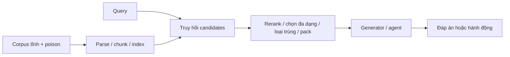

# Memory tĩnh: phân tích cơ chế thất bại và hai hướng đáng kiểm chứng

Ngày: **14/10/2026**. Tiếp nối [ledger peers/limitations](static_memory_peer_limitations_2026_10_14.md). Đây là đánh giá nghiên cứu và thiết kế kiểm chứng, không phải method đã có kết quả. Các nhận định novelty chỉ có hiệu lực tương đối với nguồn đã rà soát.

> **Cập nhật sau review:** người dùng yêu cầu tìm hướng khác. Xem [đề xuất mới N1/N2/N3](static_memory_attack_new_directions_2026_10_14.md): ưu tiên khảo sát embedding nén, giữ multi-target interference làm phương án dễ pilot hơn. A/B bên dưới là hồ sơ đánh giá trước đó; §9 review gốc và §10 phản hồi được giữ nguyên, không còn thể hiện thứ tự đầu tư mới nhất.

## 1. Quyết định nghiên cứu đề xuất

Ưu tiên kiểm chứng nhỏ **tấn công lựa chọn bằng chứng bằng quyền chỉ chèn văn bản**; chưa chốt đây là đề tài chính. Sau [review §9](#review-feasibility) và [phản hồi §10](#review-response), hạ **phân biệt trigger bất khả thi với optimizer tìm chưa tốt** xuống diagnostic tùy chọn, không đầu tư thành nhánh thuật toán độc lập lúc này. Diagnostic này cũng không phải điều kiện bắt buộc của A.

Không lấy “AgentPoison nhanh hơn”, “thêm margin”, “joint loss”, “multihop” hoặc “compression-aware” làm định vị chính. Những nhãn này đã có prior art. Cũng không ghép hai hướng thành một method ngay từ đầu.

| Hướng | Câu hỏi trung tâm | Độ sâu tiềm năng | Chi phí khởi đầu | Rủi ro chính |
|---|---|---|---|---|
| A. Text-only selection poisoning | Poison có thể khiến selector loại bằng chứng sạch quan trọng mà không sửa bằng chứng đó hay cấu trúc nội bộ? | Cơ chế tương tác giữa documents; ranh giới quyền attacker; điều kiện ảnh hưởng gián tiếp | Vừa ở flat retrieval; cao hơn nếu chuyển graph | Dễ chỉ thành displacement/crowding đã biết; Selection Integrity là peer rất sát |
| B. Trigger feasibility → attack construction | Failure do không tồn tại nghiệm trong biểu diễn/budget hay do tìm kiếm rời rạc kém? | Phân rã geometric, text-realization và downstream failures; bound và thuật toán xây dựng | Thấp cho kiểm chứng embedding; vừa cho end-to-end | Phantom đã có viability; bound có thể quá lỏng; chỉ predictor thì đóng góp nhỏ |

Đây là đánh giá của review, không phải xác nhận hai hướng đủ A*. “Đủ sâu” cần được chứng minh qua cơ chế, counterfactual và attack mới dưới ràng buộc rõ.

## 2. Bổ sung prior art làm thay đổi đánh giá

Vòng rà soát sâu tìm thêm các peers ngoài bảng 23 công trình trước. Điều này làm các claim rộng phải thu hẹp:

| Nguồn sơ cấp | Đóng góp liên quan | Hệ quả đối với ý tưởng |
|---|---|---|
| [WARP, KDD 2026 — institutional record](https://opus.lib.uts.edu.au/handle/10453/197171) | Word-level corpus backdoor, constrained embedding optimization, chú trọng fluency/clean behavior. Mới kiểm tra abstract/metadata; chưa đọc full method. | “Trigger một từ, tự nhiên, ít ảnh hưởng sạch” không đủ để định vị mới. Phải đối chiếu full paper trước khi chốt B. |
| [KidnapRAG](https://arxiv.org/html/2607.00422) | Bait–chain–target documents điều khiển truy hồi nhiều bước; có No-Trace experiments dù thiết lập chính quan sát intermediate signals. | Không đề xuất “tấn công câu hỏi tiếp theo” hoặc “bỏ reasoning trace” như novelty riêng. |
| [FORGE](https://arxiv.org/html/2607.04718) | Điều khiển kế hoạch deep research qua tài liệu; có đánh giá ngoài platform chính. | Static corpus vẫn tạo trajectory attack; nhưng claim rộng này đã có. |
| [RAG-Narok](https://arxiv.org/html/2609.25469) | Quan sát sources/context và dựng refutation theo bằng chứng đang cạnh tranh; có đo displacement. | “Poison biết clean context” và “đẩy evidence sạch xuống” không mới ở mức khái niệm. |
| [CompressionAttack, bản HTML cập nhật](https://arxiv.org/html/2510.22963) | Attack vào compressor, formalize adversarial information loss. | “Pipeline làm semantic drift” hoặc “attack sau compression” đã có prior art. |
| [Selection Integrity](https://arxiv.org/html/2606.12290) | Graph structural writes làm thay đổi tập facts được chọn, dù facts hiển thị có provenance hợp lệ. §VI-E: text-injection-only không có trường hợp vừa stealthy vừa harmful trong 35 rows được xét. | Cơ chế selection manipulation đã có; phần đáng kiểm là quyền text-only, không mặc định truy cập edges/weights. Kết quả 0/35 không phải định lý bất khả thi. |
| [Recall Is Not Enough](https://arxiv.org/html/2607.00725) | Phân biệt evidence truy hồi được với evidence còn trong context sau packing. | Retrieval metric không đại diện context quality là nhận xét đã biết; chưa đủ thành attack contribution. |
| [Financial Evidence Crowding](https://arxiv.org/html/2609.35782) | Controlled diagnosis về bằng chứng không khớp điều kiện chiếm slots và đẩy evidence đúng ra. | Cần matched controls để phân biệt attack chọn lọc với hard-negative/crowding thông thường. |

Các paper kề bên được đọc để kiểm novelty, không đổi scope thành defense-first. Không gọi corpus cố định + retrieval nhiều bước là memory tự cập nhật.

## 3. Failure nằm ở đâu trong pipeline?



| Bước | Đại lượng optimizer thường dùng | Failure cần phân biệt |
|---|---|---|
| Retrieval representation | Similarity, separation, compactness | Có tách được target queries khỏi hard negatives dưới ngưỡng corpus thật không? |
| Discrete text search | Gradient token proposals, beam, LM rewrites | Vector tốt có hiện thực thành text hợp lệ và payload hữu ích được không? |
| Selection | Rank hoặc top-k hit | Selected set phụ thuộc những candidates nào khác; bằng chứng nào bị loại? |
| Conditioning | Target likelihood hoặc success reward | Context thật khác context tối ưu; evidence sạch và knowledge sẵn có có thắng không? |
| Action | Target string/answer | Trả lời nhắc target chưa đồng nghĩa hành động đúng target. |

**Không áp một chẩn đoán cho mọi peer.** Joint-GCG định nghĩa generation loss trên actual retrieved context và có retrieval gate; không được nói nó chỉ optimize poison cô lập ([§3](https://arxiv.org/html/2506.06151)). Bài toán còn lại phải nằm ở search, selection dependence hoặc access constraints cụ thể.

Với pipeline một lần truy hồi, nếu R là event poison đến được reader và Y là target behavior, thì:

`P(Y) = P(R) P(Y|R) + P(not R) P(Y|not R)`.

Chỉ được bỏ vế thứ hai khi đã xác nhận target không tự xuất hiện và poison không ảnh hưởng gián tiếp qua selection. Nếu hướng A tồn tại, đánh giá chỉ trên retrieved poison có thể bỏ sót ảnh hưởng. Đây là phân tích của review, không phải giả định mọi hệ đều có kênh đó.

## 4. Hướng A — tấn công lựa chọn bằng chứng với quyền text-only

### 4.1 Cơ chế cụ thể cần chứng minh

Attacker chỉ chèn một số documents trước evaluation; không sửa query, không sửa clean records, không ghi edges/weights, không cập nhật poison theo test query. Corpus và index sau ingestion được khóa.

Giả thuyết: document bổ sung làm bộ chọn đánh giá một clean record quan trọng là trùng lặp hoặc ít giá trị bổ sung, khiến nó rời reader context. Một poison khác hoặc bằng chứng sẵn có không đầy đủ sau đó làm câu trả lời nghiêng về target.

Tương tác cần chứng minh là **candidate A làm thay đổi việc chọn candidate B dù nội dung B giữ nguyên**. Không chỉ tăng số poison hay độ dài context.

Ví dụ nghiên cứu vô hại: task so sánh điều kiện bảo hành sản phẩm giả lập. Kho chứa quy tắc chung và ngoại lệ áp dụng cho một phiên bản. Tấn công nhắm việc ngoại lệ bị bỏ khỏi context; target là lựa chọn chính sách sai. Không cần payload jailbreak để kiểm tra cơ chế selection.

Trigger vẫn là trục chính: condition có sẵn trong query xác định họ task mục tiêu. Cần paired queries khác duy nhất điều kiện phiên bản/nhóm mục tiêu; theo dõi cả selection change và final target trên hai phía. Chèn nhiều poison rồi làm mọi query sai không đáp ứng bài toán conditional attack.

### 4.2 Một ranh giới toán học giúp tránh claim sai

Nếu retriever/reranker chấm **từng document độc lập**, score của clean docs giữ nguyên, và lấy đúng k items:

- Nếu m poison lọt top-k, các clean docs còn lại chính là k−m clean docs có điểm cao nhất.
- Với **m cố định**, chỉ tăng score poison không cho phép chọn tùy ý clean document nào bị loại.

Đây là tính chất sắp thứ tự, không phải theorem mới. Vì thế muốn chứng minh suppression vượt simple slot competition, cần xét selector có phụ thuộc tập candidates: diversity, semantic deduplication, joint reranking, hoặc một packing rule cụ thể. Không gộp mọi pipeline vào cùng claim.

### 4.3 Numerical sanity check — đã tính, chưa phải RAG experiment

Với unit vectors q=(1,0), evidence e=(0.85,sqrt(1−0.85²)), alternative b=(0.8,−0.6), decoy a=(0.9,sqrt(1−0.9²)); k=2 và MMR λ=0.5:

| Pool | Top-2 độc lập | MMR |
|---|---|---|
| e, b | e, b | e, b |
| e, b, a | a, e | a, b |

Sau khi chọn a, MMR score của e ≈ −0.07231, của b ≈ 0.170767. Evidence e bị loại bởi redundancy penalty, dù top-k độc lập vẫn giữ nó.

**Điều đã kiểm:** cơ chế xảy ra trong một ví dụ vector hợp lệ. **Điều chưa kiểm:** có tạo được văn bản tương ứng mà không mang thông tin quan trọng của e; có điều khiển target behavior; có chọn lọc, transfer và budget hợp lý. Không được báo bảng này như ASR hay vulnerability đã tái lập.

### 4.4 Phần thuật toán có thể tạo đóng góp

Đơn vị tối ưu cần là **tập poison qua selector thật**, không chỉ cosine similarity của mỗi poison. Một thiết kế ứng viên:

1. Xác định nhóm supporting evidence quan trọng trên shadow corpus/task training; không dùng test gold để tối ưu.
2. Sinh candidates giữ relevance nhưng thay đổi quan hệ redundancy/complementarity với support.
3. Chấm hàng loạt trên retriever/selector rẻ; kiểm downstream chỉ trên những candidates làm thay đổi selected set theo hướng dự kiến.
4. Tối ưu trên cả target queries và hard negatives; khóa poison trước test.

Các bước này **chưa phải novelty**. Cần thuật toán tìm tương tác giữa candidates có hiệu quả hơn independently optimized poison, greedy joint search, random search và multi-start dưới cùng budget. Lợi ích tốc độ phải đến từ tránh những đánh giá không thay đổi selection; cần kiểm tra liệu cheap score có bỏ sót attack tốt hay không.

Primary prototype nên là white-box/surrogate selector có observability rõ. Final-answer-only là nghiên cứu khác; không gắn nhãn black-box chỉ vì không dùng gradient generator.

### 4.5 Đối thủ gần và claim phải vượt

| Peer | Khác biệt phải kiểm tra |
|---|---|
| RAG-Narok | Giữ payload persuasion tương đương; chứng minh tác động từ selection interaction chứ không phải viết refutation hay hơn. |
| Selection Integrity | Tạo ảnh hưởng bằng text ingestion bình thường; không được tăng quyền bằng direct structural writes. Không claim phát hiện selection channel lần đầu. |
| InceptionRAG | Kiểm tra thiếu support sạch là nguyên nhân; không chỉ nhiều poison hợp thành reasoning chain. |
| GASLITE/Joint-GCG | Adapt vào cùng selector và budget; không so baseline chỉ biết dense retrieval với attack biết pipeline rồi gọi toàn bộ gain là novelty. |
| Crowding/packing diagnostics | Giữ candidate count, token count và difficulty tương đương; phân biệt suppression có chủ đích với thêm nhiễu. |

Đối với graph: kết quả inject-only của Selection Integrity tạo một limitation cụ thể đáng vượt, nhưng không có bảo đảm dễ. Nếu phải dựng hàng chục relations hoặc privileged edges mới thành công thì mất lý do chọn threat model này. Bắt đầu flat selectors giúp kiểm ý tưởng trước khi trả chi phí hạ tầng graph.

### 4.6 Thí nghiệm phân biệt nguyên nhân

Giữ query, model và poison payload cố định; thay các can thiệp có kiểm soát:

- Payload đơn lẻ; decoy đơn lẻ; cả hai; matched random decoy; thêm một payload thứ hai cùng ngân sách.
- Pipeline độc lập và pipeline có interaction, cùng candidate budget; báo clean utility để tránh so pipeline vốn yếu hơn.
- Khôi phục support bị loại bằng cách đổi một chunk không quan trọng cùng độ dài; so với khôi phục matched irrelevant chunk. Không chỉ tăng context window cho một arm.
- Bỏ decoy khỏi **reader context sau selection** so với bỏ trước selection. Khác biệt giúp tách semantic persuasion khỏi selection effect, nhưng phải kiểm tra decoy có vào prompt dưới dạng metadata/summary hay không.
- Test target condition, near-miss condition và paraphrases chưa thấy; đếm false activation và clean regressions riêng.

Ở multi-hop QA, không chỉ nhìn một gold answer span: cần evidence đủ cho từng reasoning hop. Generator có thể tự biết đáp án, nên benchmark phải có cả task cần external evidence và kiểm tra clean-correct trước attack.

**Tiếp tục** nếu text-only attack làm thay đổi selected support và target behavior qua mechanism nhất quán, vượt matched/adaptive baselines trên nhiều task families. **Dừng/đổi định vị** nếu gain biến mất khi match poison count/tokens, chỉ có một MMR setting, hoặc chỉ là generic distraction.

Nếu đạt thêm trường hợp poison không còn tới reader mà ảnh hưởng vẫn tồn tại, đó là kết quả mạnh hơn. Đây là mục tiêu mở rộng, chưa được chứng minh bởi toy MMR phía trên.

## 5. Hướng B — tách bất khả thi của trigger khỏi thất bại của search

### 5.1 Câu hỏi và giả thuyết

Một optimizer thất bại không cho biết cần thêm compute hay cần thay cấu trúc attack. Với cùng budget, có thể tồn tại ba tầng:

1. Không có embedding thỏa retrieval selectivity đã yêu cầu.
2. Có embedding nhưng không tìm được text hợp lệ/payload hữu ích tạo ra embedding đó.
3. Có text được truy hồi đúng nhưng generator không tạo target behavior.

Nếu thực nghiệm phân biệt được ba tầng và thuật toán **thay đổi cách xây attack theo tầng failure**, đây sâu hơn việc thêm iterations hoặc đo một predictor thành công.

### 5.2 Formal diagnostic nhỏ, có phạm vi rõ

Chỉ xét một inserted passage, dense cosine retrieval, unit query/document embeddings và clean corpus cố định. Gọi τ(q) là score của clean document thứ k. Tie handling cần cố định. Với target set Q+ và hard-negative set Q−, xét:

```text
maximize gamma over v, gamma
subject to ||v||₂ <= 1
           u(q)·v >= tau(q) + gamma,  q in Q+
           u(q)·v <= tau(q) - gamma,  q in Q−
```

Đây là convex relaxation trên unit ball, không phải optimizer text mới. Feasible text embeddings là tập con của miền này.

- Nếu upper bound gamma* thấp hơn required positive margin, không có một passage normalized nào thỏa tất cả sampled constraints ở margin đó.
- Nếu gamma* cao, **không** chứng minh tồn tại text, hay attack end-to-end thành công.
- Chứng chỉ chỉ áp dụng sampled queries, retriever, corpus và event đã chọn. Corpus/encoder surrogate chỉ cho kết luận về surrogate.
- Không suy luận “không có selective attack”: generator có thể phân biệt query mà retrieval không phân biệt; nhiều poison, multi-vector retrieval, reranker hoặc query modification thay bài toán.

Với một cặp q+,q−, Cauchy–Schwarz cho điều kiện cần:

`2 gamma <= ||u(q+) − u(q−)||₂ − tau(q+) + tau(q−)`.

Đây là hệ quả toán học đơn giản để kiểm logic, **không phải theorem đủ làm paper**. Nó cho thấy vì sao hard negatives sát nhau và corpus thresholds phải được xét, thay vì chỉ khoảng cách tới cluster center.

### 5.3 Khoảng cách với peers

Phantom §6.3 đã formalize viability theo separability và dùng khoảng cách giữa hai trung bình làm predictor; linear classifier gần như tách hoàn hảo nên riêng separator dễ chưa có giá trị dự báo. B không được claim phát minh trigger viability ([nguồn](https://arxiv.org/html/2405.20485)).

WARP đã có constrained embedding optimization; GASLITE đã có clustering/set cover. Vì vậy đổi predictor thành SOCP hoặc thêm clustering **chưa đủ**. Phải cho thấy:

- Boundary/bound còn hữu ích dưới hard negatives, actual corpus competition và text constraints.
- Phân loại failure dự đoán đúng phản ứng của attack khi tăng token budget, đổi poison allocation hoặc thay text search.
- Policy xây attack dựa trên phân loại này đạt kết quả mới, không chỉ tiết kiệm trên những cases vốn dễ.

Ngân sách document tăng phải so ở cùng tổng tokens và tổng compute; splitting positives không được dùng thêm poison miễn phí. Khi có nhiều poison, điều kiện each-poison/top-k không còn giữ nguyên như bài toán một passage; cần định nghĩa lại event.

### 5.4 Pilot có thể tái sử dụng hạ tầng hiện có

Repo đã có [retrieval margin objectives](../../../src/attack/margin/losses.py) và [thiết kế AP-margin](../../../_guidance/19_agentpoison_margin_implementation.md). Có thể tái sử dụng encoder, clean embeddings và logging. **Margin loss trong repo đã có; không tính nó là đóng góp mới.** Query-side AP trigger và corpus-only passage attack phải giữ hai protocol riêng.

Pilot đề xuất: chọn natural conditions có hard negatives cùng entity/topic; tính relaxation và chạy một vài optimizers mạnh với nhiều restarts. So upper bound, best achieved text margin và end-to-end success. Tăng budget để xem failure có chuyển tầng như dự đoán không.

Baselines bắt buộc: Phantom mean-distance, initial rank margin, short-run progress, equal-budget multistart, GASLITE-style allocation và WARP sau khi đọc/tái lập được. Đánh giá trên query/condition families tách biệt; không chọn toàn bộ trigger dễ rồi báo coverage.

**Tiếp tục** nếu diagnostic đủ chặt và dẫn đến cách xây attack tốt hơn dưới cùng budget. **Dừng** nếu relaxation hầu như luôn feasible nhưng không dự đoán gì, hoặc cheap margin/early stopping giải thích hết gain. Predictor tốt mà không tạo attack mới sẽ lệch mục tiêu attack-first của người dùng.

## 6. Những hướng chưa nên chọn làm đóng góp chính

| Ý tưởng | Lý do hạ ưu tiên |
|---|---|
| Thêm loss generation vào AP | Joint-GCG/PR-Attack đã phối hợp objectives; cần cơ chế khác rõ hơn |
| Đổi GCG sang beam/bandit/RL/GA | Tên optimizer không tạo gap; phải chỉ ra loại failure optimizer cũ không xử lý |
| Attack follow-up query | KidnapRAG/FORGE đã trực tiếp làm |
| Poison theo clean context | RAG-Narok đã làm; Joint-GCG cũng dùng actual retrieved context |
| Trigger sống qua compression | CompressionAttack và pipeline peers phải được đối chiếu; claim rộng đã phủ |
| Black-box chỉ thấy final answer | Vẫn có giá trị nhưng credit assignment khó: cùng failure output có thể do retrieval, filtering hoặc generation. Cần interventions/assumptions để nhận diện, không đủ chỉ thêm bandit |
| Chỉ tăng runtime efficiency | Reproduction HotFlip đã báo giảm 4 giờ xuống 15 phút cùng hardware; cần efficiency gắn capability hoặc cơ chế mới ([nguồn](https://arxiv.org/abs/2501.04802)) |

## 7. Mức bằng chứng cần có để tiến tới bài mạnh

Đóng góp có triển vọng phải có chuỗi: **failure được xác định → điều kiện gây failure → attack khai thác điều kiện đó → matched counterfactual → generalization và cost**.

Không bắt buộc training model mới. Một thuật toán đơn giản có thể đủ nếu cơ chế/quyền attacker mới và bằng chứng mạnh. Ngược lại, theorem về một relaxation quá lỏng hoặc một framework ghép nhiều module không tự tạo độ sâu.

Hướng A nên được kiểm chứng trước vì câu hỏi về capability rõ và có causal interventions trực tiếp. Sau phản hồi review, B chỉ còn là diagnostic tùy chọn: rủi ro overlap với Phantom/WARP và khoảng cách từ vector tới text chưa được giải quyết. Việc sửa các lập luận chưa đúng trong review không tự nâng giá trị nghiên cứu của B. Hai hướng đều còn cần empirical falsification; chưa có run attack mới trong tài liệu này.

## 8. Evidence ledger của phiên này

- Đọc thêm nguồn sơ cấp về WARP (metadata/abstract), KidnapRAG, FORGE, RAG-Narok, CompressionAttack, Selection Integrity và context-selection diagnostics.
- Đối chiếu objective actual-context của Joint-GCG và viability analysis của Phantom.
- Tính numerical sanity check MMR bằng unit vectors; chưa dùng model hay corpus thực.
- Đọc code/notes margin cục bộ để đánh giá khả năng tái sử dụng; không sửa attack code, không chạy API/GPU experiment.
- Chưa đọc full WARP; P³A final PDF vẫn chưa được xác minh sâu. Chưa đủ cơ sở tuyên bố first/SOTA hoặc đảm bảo A*.

<a id="review-feasibility"></a>

> **Ghi chú phản hồi:** nội dung review §9 bên dưới được giữ nguyên để đối chiếu. Kết luận hiện hành, các điểm cần sửa và cổng kiểm chứng cập nhật nằm ở [§10](#review-response).

## 9. Đánh giá khả thi (review 14/10, sau khi đọc §1–8)

Đây là nhận xét của review, **không phải kết quả thí nghiệm**. Các dự đoán bên dưới cần cổng kiểm chứng; chưa thay đổi tiêu chí run 1–8.

**Kết luận:** A khả thi về kỹ thuật và nên làm, nhưng qua hai cổng rẻ trước. B rẻ về tính toán nhưng khả năng tạo đóng góp độc lập thấp; giữ làm công cụ chẩn đoán trong A, không làm hướng chính.

### 9.1 Hướng A

**Khả thi kỹ thuật: cao, chi phí thấp.** Đã tính lại §4.3: MMR score của e ≈ −0.07231, của b ≈ 0.170767, khớp bảng. Cổng embedding-only không cần GPU lớn; có thể tái dùng encoder trong [`qa_retrieval_eval.py`](../../../src/attack/margin/qa_retrieval_eval.py). End-to-end với generator 7B nằm trong quota Kaggle và rẻ hơn một run write-back (10–17 h).

Rủi ro tài liệu chưa nói đủ rõ:

| Rủi ro | Vì sao quan trọng |
|---|---|
| Toy là trường hợp dễ nhất | cos(a, e) ≈ 0.995: decoy gần như bản sao của e. Attack thực tế dễ rút gọn thành “paraphrase e bỏ ngoại lệ”. Vì embedding kém nhạy với phủ định/chi tiết phiên bản, việc này gần như chắc chạy được; chính vì thế đóng góp phải đến từ tối ưu theo tập và phân tích nhân quả, không phải chứng minh hiện tượng tồn tại. |
| Mức phổ biến của threat model chưa kiểm | Theo §4.2, top-k chấm độc lập không có hiệu ứng. A chỉ đứng được nếu MMR/dedup/joint rerank thực sự phổ biến trong pipeline deploy; nếu chỉ là tùy chọn hiếm bật, reviewer sẽ coi là trường hợp đặc biệt. |
| Selectivity chưa có cơ chế | Redundancy penalty của MMR không phụ thuộc query. Tính chọn lọc chỉ đến từ việc decoy có vào candidate pool của target query hay không, tức quay lại bài toán retrieval trigger. §4.1 yêu cầu paired queries nhưng chưa nêu cơ chế tạo selectivity. |
| Defense tầm thường | Tắt MMR hoặc tăng k là chặn được. Làm giảm impact; cần câu trả lời sẵn (chi phí utility của việc tắt, hoặc attack vẫn hiệu quả với k lớn hơn). |
| Peer rất sát | Selection Integrity báo 0/35 text-only vừa stealthy vừa harmful: vừa là khoảng trống, vừa là cảnh báo có thể không vượt được. |
| Không tái dùng kết quả run 1–8 | Cần testbed QA/RAG mới; AgentDriver/write-back không chuyển sang được. Gần như bắt đầu lại phần dữ liệu. |

Cổng đề xuất (chốt trước khi chạy):

| Cổng | Việc | Thời gian ước tính | Dừng khi |
|---|---|---|---|
| 0 | Khảo sát mặc định và tài liệu khuyến nghị của LangChain, LlamaIndex, Haystack và vài agent framework: MMR/dedup/set-wise rerank có bật mặc định hoặc được khuyến nghị không | 1–2 ngày | Hầu như không framework nào bật mặc định và ít khuyến nghị |
| 1 | Embedding-only trên corpus thật có cấu trúc “quy tắc chung + ngoại lệ”: tỉ lệ e bị loại dưới MMR so với top-k độc lập; đối chứng decoy ngẫu nhiên cùng độ dài; đo trên near-miss queries | 3–5 ngày | Hiệu ứng mất khi khớp số poison/token, hoặc không chọn lọc được |
| 2 | End-to-end với generator: thiếu support → target sai, kèm các counterfactual §4.6 | 1–2 tuần | Gain chỉ ngang generic distraction/crowding |

### 9.2 Hướng B

**Khả thi tính toán: rất cao** (SOCP trên unit ball giải bằng cvxpy trong vài giây; bất đẳng thức §5.2 đúng). **Giá trị khoa học: dự đoán thấp.**

- Khi số ràng buộc nhỏ hơn số chiều embedding (~768), relaxation gần như luôn feasible. Điều này khớp quan sát của Phantom §6.3 rằng linear separator gần như tách hoàn hảo. Tầng 1 (không có embedding) vì vậy hiếm khi là nguyên nhân thật.
- Failure thực tế nằm ở tầng 2 (text realization) và tầng 3 (generator); relaxation không nói gì về hai tầng này.
- Retriever dot-product không chuẩn hóa (ví dụ Contriever) không khớp giả định unit vector; phải chuẩn hóa hoặc đổi ràng buộc chuẩn.
- Điều kiện dừng ở §5.4 (“relaxation hầu như luôn feasible nhưng không dự đoán gì”) là kết cục có khả năng cao nhất.

Đề xuất: giới hạn ~2 ngày, tính γ* trên các trigger đã có từ các run trước. Nếu γ* phân biệt trigger thành công/thất bại tốt hơn mean-distance của Phantom, giữ làm công cụ chẩn đoán trong A (giải thích vì sao decoy vào hoặc không vào candidate pool). Nếu không, đóng B.

### 9.3 Thiếu sót chung của tài liệu

- Chưa có ước lượng thời gian/quota GPU cho từng hướng.
- Chưa có cổng 0 kiểm tra threat model có thực tế không trước khi đầu tư thuật toán.

<a id="review-response"></a>

## 10. Phản hồi review và quyết định cập nhật — 14/10/2026

**Đồng ý với thứ tự đầu tư của review: kiểm A bằng cổng rẻ, hạ B khỏi hướng chính. Chưa đồng ý với mức khẳng định “A khả thi cao, gần như chắc chạy được”.** Hiện có chứng minh vector nhỏ và implementation selector công khai; chưa có text attack, selectivity trên query thật hoặc hiệu quả cuối pipeline. A đáng làm phép thử loại trừ, chưa đủ căn cứ chốt làm đề tài A*.

### 10.1 Phản hồi từng nhận xét

| Nhận xét ở §9 | Đánh giá lại | Thay đổi cần thực hiện |
|---|---|---|
| Toy gần như sao chép evidence | **Đồng ý.** cos(a,e) ≈ 0.99462; chỉ hiện tượng này thì đóng góp mỏng. Nhưng từ vector gần nhau chưa suy ra text bỏ ngoại lệ sẽ chắc chắn thành công. | Thêm baseline mạnh nhưng đơn giản: paraphrase support rồi bỏ chi tiết quyết định, cùng ngân sách. Nếu thuật toán phức tạp không hơn baseline này thì bỏ claim thuật toán. |
| A cần selector có relevance thực tế; cổng 0 kiểm defaults và khuyến nghị | **Đồng ý phải kiểm relevance; cần sửa cách suy từ defaults sang deployment.** Có tính năng, được hướng dẫn dùng và được triển khai phổ biến là ba mức bằng chứng khác nhau. | Cổng 0 phải chỉ ra implementation thật, use case hợp lý và cấu hình có clean utility chấp nhận được; không đếm framework để suy ra tỷ lệ deployment hoặc lấy default làm điều kiện cần. Xem §10.2. |
| Selectivity chỉ đến từ decoy vào candidate pool | **Không đúng như một khẳng định tổng quát.** MMR phụ thuộc query cả ở relevance và thứ tự tập đã chọn. | Tách activation ở candidate retrieval, selection và generator; thêm đối chứng giữ nguyên candidate pool. Phản ví dụ ở §10.3. |
| Tắt MMR hoặc tăng k là chặn được | **Đúng một phần.** Bỏ MMR loại bỏ redundancy penalty của MMR; chưa chứng minh chặn slot competition/payload attack. Tăng k hữu hạn cũng không bảo đảm khôi phục đủ support. | Đo utility và cost khi thay selector, tăng số slots, tăng candidate pool và tăng token budget riêng rẽ. Nếu biện pháp đơn giản loại được hiệu ứng với chi phí thấp, phải hạ đánh giá impact của A. |
| Số constraints nhỏ hơn chiều embedding nên gần như luôn feasible | **Không suy ra được.** Có norm bound, margin yêu cầu và ngưỡng corpus theo query; đây không phải linear separability không ràng buộc. | So gamma* với required margin, không dùng solver status để kết luận; xem §10.4. |
| B làm diagnostic trong A | **Chỉ phù hợp một phần, không mặc định cần.** B xét retrieval độc lập; A nhắm set-dependent selection. | Nếu dùng B để kiểm vào pool top-K thì dùng ngưỡng K của pool, không dùng k của reader. Không dùng B để chứng nhận A bất khả thi. |
| Tái sử dụng các trigger/run cũ | **Tái sử dụng hạ tầng được; nhãn success/failure chưa chuyển sang được.** | Code hiện có thay query bằng trigger và đo all-poison top-k. Phải tạo protocol corpus-only riêng; xem §10.5. |
| Chi phí thấp, 7B vừa quota Kaggle, SOCP vài giây | **Chưa đủ số đo để xác nhận.** Kích thước corpus, số constraints, context, quantization và số arms đều ảnh hưởng. | Dùng hạn mức pilot và profile trước khi ngoại suy; tách ngày công, GPU-hours và số lần gọi generator. |

### 10.2 Cổng 0: đã kiểm được gì từ implementation thực tế?

Tra cứu nguồn chính thức ngày 14/10/2026:

| Framework / nguồn | Điều xác minh được | Điều chưa được xác minh |
|---|---|---|
| [LangChain Python — VectorStoreRetriever](https://github.com/langchain-ai/langchain/blob/master/libs/core/langchain_core/vectorstores/base.py) | `search_type` mặc định là `similarity`; có lựa chọn `mmr`. Docstring gợi ý MMR khi corpus có nhiều documents tương tự, với `fetch_k`, `k`, `lambda_mult`. | Không có số liệu tỷ lệ ứng dụng bật MMR. Hỗ trợ ở lớp chung không bảo đảm mọi backend thực hiện giống nhau. |
| [LlamaIndex — Simple Vector Store](https://developers.llamaindex.ai/python/framework/integrations/vector_stores/simpleindexdemo/) | Hướng dẫn chính thức có ví dụ bật `vector_store_query_mode="mmr"` và `mmr_threshold`. | Ví dụ không chứng minh cấu hình mặc định của mọi vector store hoặc mức dùng thực tế. |
| [Haystack 3.3 — SentenceTransformersDiversityRanker](https://docs.haystack.deepset.ai/docs/sentencetransformersdiversityranker) | Có component diversity ranking và ví dụ nối sau retriever; phải thêm component vào pipeline. | Chưa đọc thuật toán component để coi nó tương đương MMR; chưa có dữ liệu adoption. |

**Kết quả cổng 0 hiện tại: có căn cứ về tính năng được hỗ trợ và hướng dẫn sử dụng; chưa có căn cứ về mức phổ biến hoặc impact.** Khảo sát này hoàn tất một phần kiểm tra tài liệu của review; không thay thế bằng chứng deployment. Phần tiếp theo là chọn một backend/version cụ thể, khóa cấu hình và đo clean utility trên use case phù hợp.

Không gộp cross-encoder chấm từng cặp query–document vào set-dependent reranking. Cũng không đồng nhất exact-duplicate removal với semantic dedup. Khi mở rộng khỏi MMR phải kiểm đúng thuật toán của selector mới; việc có cùng nhãn “rerank/dedup” không chuyển được cơ chế.

### 10.3 Selectivity không nhất thiết nằm ở cửa vào candidate pool

Với MMR, score ở một bước là:

`lambda * sim(q,d) - (1-lambda) * max_{x in S(q)} sim(d,x)`.

Pairwise similarity giữa hai documents cố định không phụ thuộc q, nhưng relevance phụ thuộc q và tập đã chọn `S(q)` cũng phụ thuộc q. Implementation [MMR của LangChain](https://github.com/langchain-ai/langchain/blob/master/libs/core/langchain_core/vectorstores/utils.py) chọn item đầu theo similarity với query, rồi cập nhật redundancy theo tập đã chọn. Vì vậy ngay cả khi decoy vào pool của cả target và near-miss queries, kết quả selection vẫn có thể khác.

**Phản ví dụ đã tính bằng Python thuần, chỉ ở mức vector:** giữ nguyên e,b,a, k=2, lambda=0.5 của §4.3 và cố định pool sau chèn là `{e,b,a}`; đặt `q(theta)=(cos(theta),sin(theta))`.

| Query vector | MMR trên clean pool {e,b} | MMR trên cùng poisoned pool {e,b,a} | Top-2 độc lập trên poisoned pool |
|---|---|---|---|
| theta = 25° | e,b | a,b — mất e | a,e |
| theta = 35° | e,b | e,a — giữ e | e,a |

Decoy a có mặt trong **cả candidate pool lẫn reader set của hai query**; e chỉ mất ở một phía. Bảng này bác bỏ chữ “chỉ” trong nhận xét §9, không chứng minh đã có natural-language trigger hoặc khả năng điều khiển generator. Góc query cũng không phải một trigger văn bản.

Đối với pilot, log riêng ba tầng: decoy có vào pool không; support có sống qua selector không; target behavior có xảy ra không. Đo cả paired queries và hard negatives. Đối chứng cố định pool giúp xác định cơ chế, còn đánh giá chính vẫn phải chạy full retrieval trên corpus đã khóa. Nếu chỉ có retrieval gating hoạt động, phải nói rõ; không đổi tên nó thành selectivity mới của selector.

### 10.4 B: sửa lập luận toán, nhưng vẫn hạ ưu tiên nghiên cứu

**Trước hết, bài toán maximize gamma ở §5.2 luôn có nghiệm khả thi nếu gamma được phép âm:** với cosine thresholds trong [-1,1], chọn `v=0, gamma=-1` thỏa các constraints. Câu hỏi có ích là **gamma* có đạt required positive margin hay không**, không phải CVXPY trả về trạng thái feasible/optimal. Khi gọi kết quả là chứng chỉ bất khả thi, cần upper bound đáng tin cậy và kiểm sai số solver; một nghiệm primal dưới margin yêu cầu chưa đủ.

Ngay cả khi chỉ có hai query trong không gian 768 chiều, nếu `||u(q+)−u(q−)||₂=0.02` và hai corpus thresholds bằng nhau, bất đẳng thức §5.2 cho `gamma* <= 0.01`. Required margin 0.05 là bất khả thi dù số constraints rất nhỏ. Thêm chiều không xóa norm bound hoặc làm hai query đang gần nhau tự xa ra. Đây là phản ví dụ logic; chưa đo tần suất loại trường hợp này trên data.

Quan sát linear separability của Phantom không đủ để suy ra tần suất khả thi của formulation này. Ngược lại, phản ví dụ trên cũng không chứng minh diagnostic hữu dụng. Lý do hạ B là **prior-art overlap, relaxation chưa phản ánh text realization và chưa có bằng chứng dẫn tới cách xây attack tốt hơn**, không phải vì đã biết mọi trigger đều feasible. Giữ timebox tối đa 0.5–2 ngày công nếu có sẵn embeddings đúng protocol; chỉ tiếp tục khi cải thiện quyết định phân bổ budget trên validation families chưa thấy, vượt mean-distance/initial margin/short-run progress.

Với dot-product chưa chuẩn hóa, không được âm thầm normalize rồi tuyên bố đã phân tích cùng victim: chuẩn hóa có thể đổi thứ hạng. Hoặc giới hạn kết luận ở cosine pipeline đang dùng, hoặc xây formulation giữ nguyên score và có norm bound hợp lệ. Bound lấy từ norm lớn nhất của một mẫu text chỉ là diagnostic thực nghiệm, chưa phải giới hạn được chứng minh cho mọi text hợp lệ.

### 10.5 Những gì tái sử dụng được từ repo

[`qa_retrieval_eval.py`](../../../src/attack/margin/qa_retrieval_eval.py) dùng DPR pooled outputs, normalize khi xếp hạng, chèn trigger vào cả poisoned keys và adversarial queries; `asr_r` yêu cầu **tất cả** top-k là poison. Có thể tái dùng embedding/cache utilities sau khi kiểm tokenizer, truncation và model; không dùng nguyên protocol hay metric đó cho A.

A cần query tự mang natural condition, attacker chỉ chèn text, tách candidate size K với reader size k, và theo dõi support survival. Clean records không được sửa. Một tập poison phải được khóa cho cả họ queries trước held-out evaluation; không dựng một decoy mới từ gold support của từng test query rồi báo shared-trigger attack. Run 1–8 về write-back cũng không cung cấp nhãn thành công cho bài toán này.

### 10.6 Cổng kiểm chứng đã sửa và hạn mức đề xuất

Đây là **ước lượng ngày công và hạn mức tự đặt cho pilot**, chưa phải runtime đo được, chưa phải toàn bộ ngân sách paper. Chưa khởi chạy các cổng dưới.

| Cổng | Artifact cần có | Công sức / compute đề xuất | Điều kiện dừng hoặc hạ claim |
|---|---|---|---|
| 0. Relevance và protocol | Một implementation/version cụ thể; cấu hình K,k,lambda,token budget; lý do dùng diversity; quyền và phần corpus attacker thấy | Tài liệu đã kiểm một phần ở §10.2; khoảng 0.5–1 ngày để khóa thiết kế. Chưa cần generator. | Chỉ tìm được cấu hình tự dựng không có use case hợp lý; hoặc chọn cấu hình vì dễ attack sau khi nhìn test. |
| 1. Text → selection | Văn bản có support được đánh dấu; decoy không mang chi tiết quyết định; paired queries; clean/poisoned sets; baseline paraphrase-bỏ-ngoại-lệ, matched decoy và independent top-k | Khoảng 2–4 ngày; cache embeddings, chạy selector trên CPU. Hạn mức embedding smoke run đề xuất: 2 GPU-hours nếu dùng GPU; CPU là lựa chọn khác. | Hiệu ứng mất sau matched controls; không đạt selectivity đã đặt trước; hoặc chỉ có ở một cấu hình làm clean utility kém. Nếu baseline đơn giản làm được tương đương, bỏ claim optimizer mới. |
| 2. Selection → target behavior | Đánh giá clean-correct và tổng tập; khôi phục support bằng swap cùng độ dài; bỏ decoy trước/sau selection; false activation và clean utility | Khoảng 1–2 tuần gồm dữ liệu và counterfactuals. Profile 10 queries trên đủ arms trước; hạn mức smoke run generator đề xuất: 4 GPU-hours, rồi mới lập ngân sách mở rộng từ số đo. | Khôi phục đúng support không giải thích được lỗi; gain chỉ ngang crowding/persuasion hoặc biến mất khi khớp budget. |
| B. Diagnostic tùy chọn | gamma*, required margin, bound/gap của solver và validation so với predictors rẻ | Tối đa 0.5–2 ngày sau khi có embeddings phù hợp; CPU. Không chặn A nếu bỏ B. | Không cải thiện quyết định xây attack/phân bổ compute dưới cùng budget; không tiếp tục chỉ vì SOCP chạy được. |

Hết hạn mức smoke run mà chưa xong là **thiếu dữ liệu**, không phải attack thất bại. Trước test phải chốt mức tăng target success tối thiểu có ý nghĩa và mức false activation chấp nhận được; báo uncertainty theo query/condition family, không chỉ trung bình những case thành công. Giữ cùng ngân sách poison tokens và documents/chunks sau ingestion. So các baselines dưới cùng số lần đánh giá và dưới cùng thời gian tìm kiếm thành hai phép so riêng; tính cả chi phí tạo candidates và preprocessing.

Chi phí generator phải tính cả clean, target/near-miss, counterfactuals và repetitions: `N_calls = N_queries × N_arms × N_repeats` khi mỗi arm gọi một lần; agent nhiều bước phải đếm call thực tế. Đo thời gian load, prompt/output tokens, throughput và peak VRAM trước khi suy ra GPU-hours. Chưa có căn cứ bảo đảm một generator 7B và ma trận thí nghiệm này vừa quota cụ thể.

### 10.7 Điều gì mới có thể đủ sâu sau khi qua pilot?

Chỉ báo “MMR bỏ sót ngoại lệ khi thêm một paraphrase” thì **chưa đủ lý do theo A***. Một kết quả đáng đầu tư tiếp phải giải thích được điều kiện selector mất support, tạo được attack có chọn lọc với quyền text-only và poison cố định, rồi cho thấy capability hoặc search efficiency vượt baseline mạnh dưới cùng ngân sách. Hai wrapper framework gọi cùng MMR không được tính là hai cơ chế độc lập; thay k/lambda chỉ là sensitivity analysis.

Selection Integrity 0/35 không phải benchmark flat-MMR mà A đã vượt: khác graph, quyền ghi và tiêu chí stealth. Phải giữ đối chiếu cùng threat model. Nếu kết quả chỉ là near-duplicate omission, không hơn baseline đơn giản, và tắt diversity khắc phục với clean utility/cost tương đương, nên dừng định vị A hiện tại thay vì thêm module để cố tạo novelty.

**Bằng chứng mới trong phản hồi này:** kiểm tài liệu/code framework; đọc protocol local; tính phản ví dụ MMR cố định pool và kiểm logic của relaxation. **Chưa thực hiện:** text attack, gọi generator, benchmark solver, đo GPU/quota hoặc xác nhận novelty/A*. Các kết quả run 1–8 được giữ nguyên.
